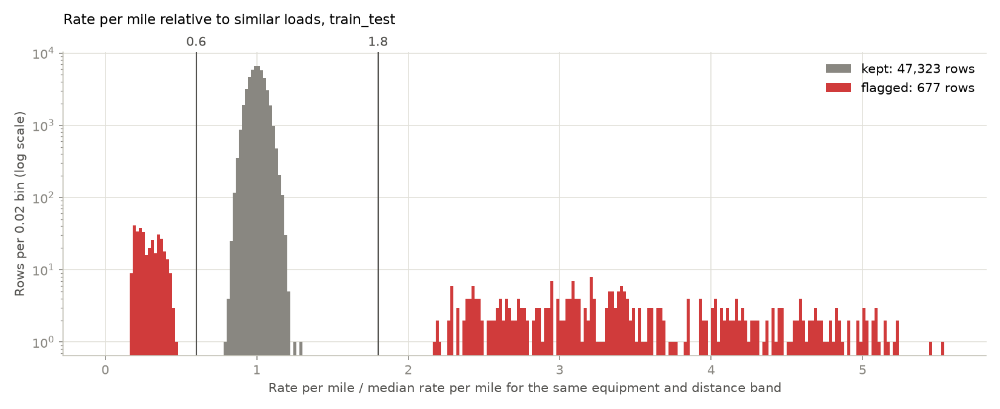
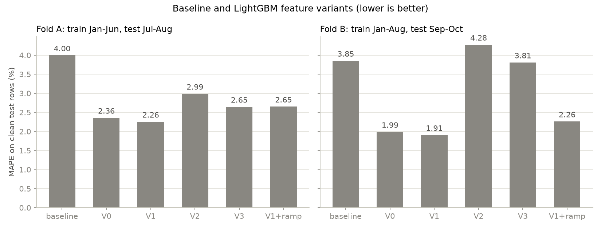
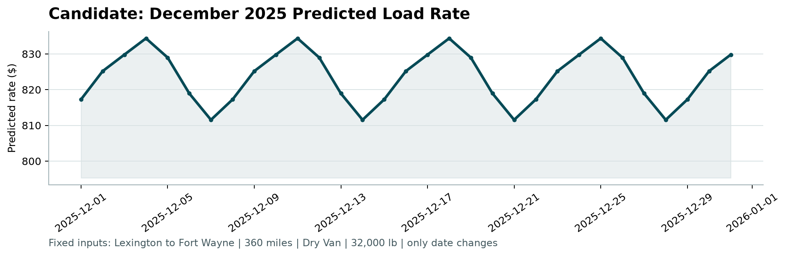

# Freight rate prediction: approach and results

The goal is to predict the posted rate (USD) of truck loads: learn from 48,000 loads from January to October 2025, then predict 12,000 loads from November and December. The final model is LightGBM on log(rate) with nine inputs: distance, weight, a weight-cap flag, equipment, pickup and delivery coordinates, and day of week. On two time-based validation folds its MAPE on clean test rows is 2.26% and 1.91%, against 4.00% and 3.85% for a simple baseline.

## 1. Data

Each load has pickup and delivery cities with coordinates, distance, equipment (Dry Van, Reefer or Flatbed), weight, date, a daily market_index and a quote_signal. Coordinates are consistent per city but don't match real geography, so they are used as given. Distance drives the rate: the median is $2.15 per mile, higher on short lanes and for Reefer and Flatbed. One cleaning function, used for training and prediction alike, handles four issues:

| Issue | Rows (train_test / validation) | Handling |
|---|---|---|
| Corrupted rates | 677 / not applicable | Removed from training only (rule below) |
| Weight sign flipped (negative) | 292 / 145 | abs() |
| Weight at the 47,500 lbs cap | 1,204 / 301 | Kept at 47,500, with a flag |
| Weight missing | 300 / 165 | Training median per equipment (~31,500 lbs), with a flag |
| Missing market_index | 374 / 249 | One value per day plus small noise, so filled with that day's mean |
| quote_signal leaks the rate | all rows | Kept in the data, not used as a model input |

**Corrupted rates.** Each load's rate per mile is divided by the median for the same equipment and distance band (0-150, 150-300, 300-600, 600-1,000, 1,000-2,000, 2,000+ miles). Normal loads sit between 0.80 and 1.30; 677 loads (1.4%) sit at 0.48 or below, or 2.16 or above, with nothing in between (Figure 1). Loads below 0.6 or above 1.8 are flagged: 337 low, 340 high. A flat cutoff at $1.20 and $5.00 per mile would miss 25 of them, mostly long Dry Van loads at $4-5 per mile.

**quote_signal.** On clean rows, it is almost exactly the rate per mile in January, February, March, June and September (correlation +1.00), mirrored in April, May, July and October (about 4.15 minus the rate per mile, correlation -0.99), and unrelated in August (-0.02). November and December look like August: its correlation with distance is 0.02 and 0.01, against about ±0.7 in every other month. Trained on January-July and tested on August, V1 with quote_signal has 4.65% clean MAPE against 1.82% without it; on fold B, where it carries the rate, it would help (1.49% against 1.91%).

**New cities.** Eight cities appear only in validation (Allentown, Charlotte, Chicago, Jackson, Knoxville, Laredo, Norfolk, San Diego), on 1,447 loads (12.1%), so the model uses coordinates and distance, never city names. Their predicted rate per mile is 0.999 times the training median for similar loads (5-95%: 0.93-1.07), against 0.998 for known cities.

## 2. Split and validation

Validation copies the real task, predicting the two months after the training data: fold A trains on January-June and tests on July-August; fold B trains on January-August and tests on September-October. A random split would be too optimistic: rates move over time (seasonal level about ±5%, climbs through quarter-end months), and it would put loads from the test days into training, so the model would be scored on days it has already seen.

Errors are reported on all test rows and on clean test rows (corrupted rates removed), because it is not known whether the final scoring includes corrupted labels. Corrupted rows add 2.2-2.5 points of MAPE and keep all-rows RMSE at $620-645 for every model, so models are compared on clean-row MAPE.

## 3. Model

The baseline predicts the training median rate per mile for the load's distance band and equipment, times distance. The model is LightGBM on log(rate) with fixed settings (600 trees, learning rate 0.05, 31 leaves, at least 50 loads per leaf); L1 loss and smaller trees were no better. Five feature sets were compared:

- V0: distance, weight, weight-cap flag, equipment, pickup and delivery coordinates
- V1: V0 + day of week
- V2: V1 + month in quarter + day of quarter
- V3: V2 + market_index
- V1+ramp: V1 + day of month in March, June, September and December (0 in other months)

| Model | Clean MAPE, fold A | Clean MAPE, fold B | All-rows MAPE, fold A | All-rows MAPE, fold B |
|---|---|---|---|---|
| Baseline | 4.00% | 3.85% | 6.23% | 6.36% |
| V0 | 2.36% | 1.99% | 4.61% | 4.51% |
| **V1 (chosen)** | **2.26%** | **1.91%** | **4.51%** | **4.42%** |
| V2 | 2.99% | 4.28% | 5.24% | 6.73% |
| V3 | 2.65% | 3.81% | 4.86% | 6.22% |
| V1+ramp | 2.65% | 2.26% | 4.88% | 4.78% |

V1 is chosen: lowest clean MAPE on both folds (MAE $53 and $43), better than V0 on 60% and 52% of test days, and its weekday effect is real (raw rates are about 1% higher on Thursdays and 1% lower on Sundays and Mondays). Distance carries 99% of the gain; the improvement over the baseline is mostly a smooth rate-per-mile curve over distance instead of six bands.

Every attempt to model change over time made things worse. Quarter features (V2) learned the levels of the few training quarters, not a repeating pattern (fold B: September 3.5% too high, October 4.9% too low). Raw market_index (V3) is confounded with the season (October 5.2% too low). Weighting recent loads more (half-lives of 30, 60, 90 days) was worse on fold A and gained at most 0.08 points on fold B, below the 0.1-point bar set in advance. The quarter-end ramp (V1+ramp) was worse on both folds (2.65% and 2.26%, against 2.26% and 1.91% for V1) and over-predicted September by 1.8%.

## 4. December chart

The chart fixes the load (Lexington to Fort Wayne, 360 miles, Dry Van, 32,000 lbs) and changes only the date. Coordinates come from the training data, where both cities appear; 32,000 lbs is below the cap, so the cap flag is off. The line is a weekly rhythm and nothing else: $834.36 on Thursdays, $811.55 on Sundays, mean $823.76. The scorer zooms the y-axis, so this 2.8% swing looks larger than it is. Scaled to 360 miles, same-lane Dry Van loads paid a median of $804 in training (21 loads), and Dry Van loads of 340-380 miles on any lane $838 (656 loads).

The main known limitation: rates climbed 4.5%, 3.3% and 2.8% through March, June and September (last week against first week), then dropped 3.3%, 3.7% and 2.0% when the next quarter started. December also ends a quarter, but no feature tested could learn this from three quarters of history, so late-December predictions may be 2-4% low.

## 5. Limits and next steps

- Quarter-end climb: late December may be 2-4% low; a second year of data would allow a seasonal feature.
- No trend: November-December are predicted at the January-October average level (July was 2.1% low). Monthly re-training and error tracking would catch level shifts.
- quote_signal copies the rate in most months but not in August or November-December; knowing what it is could make it the most useful input.
- 1.4% of rates are off by a factor of 2 to 6; their source should be fixed upstream. If the final scoring includes them, they will dominate RMSE.
- Ten months of data, coordinates that don't match real geography, and no holiday information (Christmas gets the Thursday high) limit what can be learned.
